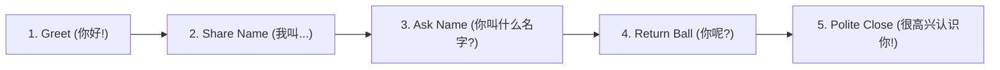

# Field Guide 01: Meet People & Self-Introductions

_Source: SayMei Beginner Field Guide · Speaking: Starter_  
_Corresponding SRS Deck: Pack 24 (Field Guide: Self-Introductions & Social Connections)_

---

## 1. The 5-Step Introduction Loop

In natural Mandarin conversation, an introduction is a two-way collaborative exchange, not a monologue. Move through these five jobs:

| Step          | Job                 | Model Phrase   | Pinyin                 | English Meaning    |
| :------------ | :------------------ | :------------- | :--------------------- | :----------------- |
| **1. Greet**  | Open connection     | 你好！         | Nǐ hǎo!                | Hello!             |
| **2. Share**  | Give one detail     | 我叫大卫。     | Wǒ jiào Dàwèi.         | My name is David.  |
| **3. Ask**    | Invite other person | 你叫什么名字？ | Nǐ jiào shénme míngzi? | What is your name? |
| **4. Return** | Bounce back topic   | 你呢？         | Nǐ ne?                 | And you?           |
| **5. Close**  | Warm wrap-up        | 很高兴认识你。 | Hěn gāoxìng rènshí nǐ. | Nice to meet you.  |

---

## 2. Core Sharing Frames

### Origin & Nationality

- **Structure A (Country + 人)**: `我是 [国家] 人。` (e.g. 我是英国人。 · _Wǒ shì yīngguó rén._)
- **Structure B (来自 + City/Place)**: `我来自 [城市]。` (e.g. 我来自伦敦。 · _Wǒ láizì Lúndūn._)
- **Question**: `你是哪国人？` (_Nǐ shì nǎ guó rén?_) or `你是哪里人？` (_Nǐ shì nǎlǐ rén?_)

### Profession & Study

- `我是大学生，我学中文。` (_Wǒ shì dàxuéshēng, wǒ xué zhōngwén._ — I am a college student, I study Chinese.)
- `我在一家公司工作。` (_Wǒ zài yì jiā gōngsī gōngzuò._ — I work at a company.)

### Personal Life & Hobbies

- `我喜欢在家听音乐。` (_Wǒ xǐhuan zài jiā tīng yīnyuè._ — I like listening to music at home.)
- `我喜欢跑步和做饭。` (_Wǒ xǐhuan pǎobù hé zuòfàn._ — I like jogging and cooking.)

---

## 3. Polite Deflection & Topic Redirection

You are never obligated to answer personal questions (age, marital status, salary). Use these safe native responses:

- **Prefer not to say**: `这个我不太想说，不好意思。` (_Zhège wǒ bú tài xiǎng shuō, bù hǎoyìsi._ — I'd rather not say, sorry.)
- **Still deciding**: `我还在想。你呢？` (_Wǒ hái zài xiǎng. Nǐ ne?_ — I'm still thinking about it. What about you?)
- **Change topic politely**: `我们聊点别的吧，今天天气真好！` (_Wǒmen liáo diǎnr bié de ba, jīntiān tiānqì zhēn hǎo!_ — Let's talk about something else, the weather today is really nice!)
