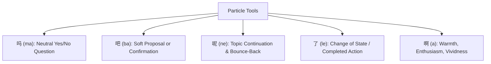

# Field Guide 04: Spoken Particles & Conversational Nuance

_Source: SayMei Beginner Field Guide · Speaking: Confident Beginner_  
_Corresponding SRS Deck: Pack 27 (Field Guide: Conversational Particles & Nuance)_

Particles don't translate into single English words; they perform **communicative jobs** at the end of clauses.

---

## The 5 Essential Spoken Particles

### 1. 吗 (_ma_) — Neutral Inquiry

- **Job**: Transforms a declarative statement into a yes/no question without rearranging word order.
- **Example**: `你喜欢咖啡吗？` (_Nǐ xǐhuan kāfēi ma?_ — Do you like coffee?)

### 2. 吧 (_ba_) — Proposal & Soft Direction

- **Job 1 (Proposal)**: `我们先吃饭吧。` (_Wǒmen xiān chīfàn ba._ — Let's eat first.)
- **Job 2 (Soft direction)**: `请进，你先坐吧。` (_Qǐng jìn, nǐ xiān zuò ba._ — Please come in, have a seat first.)
- **Job 3 (Confirmation tag)**: `你是明天下午到，对吧？` (_Nǐ shì míngtiān xiàwǔ dào, duì ba?_ — You arrive tomorrow afternoon, right?)

### 3. 呢 (_ne_) — Returning Topics & Elliptical Questions

- **Job 1 (Bounce-back)**: `我很好，你呢？` (_Wǒ hěn hǎo, nǐ ne?_ — I'm good, and you?)
- **Job 2 (Missing item inquiry)**: `我的手机呢？` (_Wǒ de shǒujī ne?_ — Where's my phone?)
- **Job 3 (Ongoing action)**: `想什么呢？` (_Xiǎng shénme ne?_ — What are you thinking about?)

### 4. 了 (_le_) — Change of State

- **Job**: Signals a new situation or threshold reached.
- **Example 1**: `时间到了，我们走吧。` (_Shíjiān dào le, wǒmen zǒu ba._ — Time's up, let's head out.)
- **Example 2**: `太好了！` (_Tài hǎo le!_ — Fantastic! / That's great!)

### 5. 啊 (_a_) — Warmth & Confirmation

- **Job**: Softens tone, adds friendliness or expressive emphasis.
- **Example 1**: `好啊，我们一起去！` (_Hǎo a, wǒmen yìqǐ qù!_ — Great, let's go together!)
- **Example 2**: `这样啊，我明白了。` (_Zhèyàng a, wǒ míngbai le._ — Oh I see, I understand now.)
