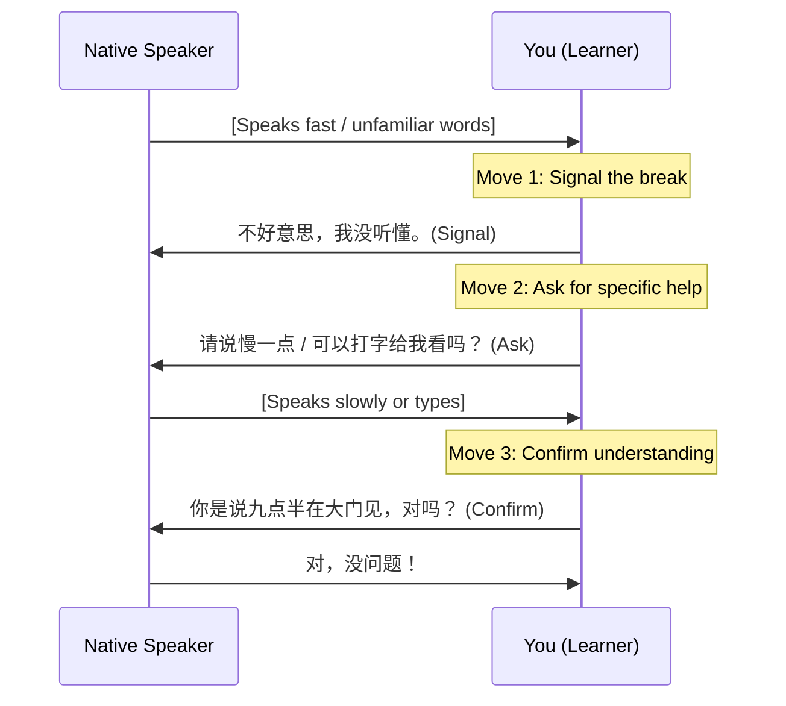

# Field Guide 05: Conversation Rescue & Repair Loops

_Source: SayMei Beginner Field Guide · Speaking: Confident Beginner_  
_Corresponding SRS Deck: Pack 28 (Field Guide: Conversation Rescue & Repair Loops)_

When native speech is too fast, unfamiliar, or noisy, conversations easily break down. Do not freeze or say nothing. Execute the **3-Move Rescue Loop**.

---

## The 3-Move Rescue Loop

---

## Move Toolkit

### Move 1: Signal the Problem

- `不好意思，我没听懂。` (_Bù hǎoyìsi, wǒ méi tīngdǒng._ — Excuse me, I didn't understand.)
- `我没听清楚。` (_Wǒ méi tīng qīngchu._ — I didn't hear clearly.)

### Move 2: Ask for Specific Help

- **Speed**: `请说慢一点。` (_Qǐng shuō màn yìdiǎnr._ — Please speak a bit slower.)
- **Repetition**: `请再说一遍。` (_Qǐng zài shuō yí biàn._ — Please say that once more.)
- **Visual backup**: `可以帮我写下来吗？` (_Kěyǐ bāng wǒ xiě xiàlái ma?_ — Could you write it down?)
- **Phone typing**: `可以打字给我看一下吗？` (_Kěyǐ dǎzì gěi wǒ kàn yíxià ma?_ — Could you type it on your phone?)
- **Pacing**: `可以一句一句地说吗？` (_Kěyǐ yí jù yí jù de shuō ma?_ — Can you speak sentence by sentence?)
- **Vocabulary inquiry**: `这个用中文怎么说？` (_Zhège yòng zhōngwén zěnme shuō?_ — How do you say this in Chinese?)

### Move 3: Confirm What You Understood

- `你的意思是……对吗？` (_Nǐ de yìsi shì... duì ma?_ — Do you mean..., right?)
- `懂了，谢谢你的耐心！` (_Dǒng le, xièxie nǐ de nàixīn!_ — Understood, thanks for your patience!)
